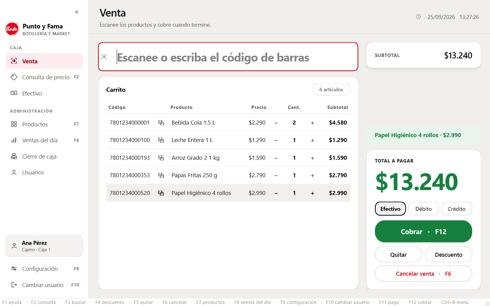

# Tienda POS — prototipo

Prototipo de sistema de punto de venta para una tienda pequeña (almacén / minimarket).
Aplicación de **escritorio Windows**: el usuario abre un acceso directo y el programa arranca.
No es una aplicación web y no requiere internet.

El núcleo es lo que pidió el cliente: **código de barras → producto → precio**.
Alrededor de eso, el prototipo demuestra una venta completa e inventario mínimo.



## Qué hace

- **Venta**: escaneo, carrito con agrupación de repetidos, **búsqueda por nombre al lado del
  código**, descuento por monto o porcentaje, **venta por peso** (pan, jamón), medio de pago
  (efectivo, débito o crédito), **vuelto** en efectivo y **recargo por cajetilla de cigarros**
  pagada con tarjeta.
- **Dos cajas** sobre la red local: la principal guarda la base y la secundaria se la pide.
- **Usuarios por empleado**, cada uno con su PIN, y administrador para lo delicado.
- **Arqueo de caja**: apertura, retiros y pagos a proveedor, cierre contando a ciegas.
- **Informes**: ventas del día y cierre diario por caja, por medio de pago y por empleado.
- **Catálogo** para todos los empleados: alta, edición, stock, baja y códigos pendientes.
- **Consulta de precio** a pantalla completa (F2).
- Funciona **sin internet**, con respaldo automático de la base de datos en cada arranque.

## Estado

**En producción en la tienda del cliente** (Punto y Fama, botillería y market) desde el
2026-09-26, en dos PC. La última actualización instalada es la de las fases 25 y 26 (2026-10-10).
Qué está hecho, qué falta y cómo retomar: [docs/PLAN.md](docs/PLAN.md), apartado "Cómo retomar".
Cómo está instalado: [docs/DESPLIEGUE-TIENDA.md](docs/DESPLIEGUE-TIENDA.md).

## Requisitos

- Windows 10 u 11
- Python 3.11 o superior (solo para desarrollo; el ejecutable final no lo necesita)

## Ejecutar en desarrollo

```bash
python -m venv .venv
.venv\Scripts\activate
pip install -r requirements-dev.txt
python main.py
```

## Pruebas

```bash
pytest
```

## Construir el ejecutable

```bash
python tools/construir.py
python tools/crear_acceso_directo.py
```

Genera `dist/PuntoYFamaCaja/PuntoYFamaCaja.exe` y deja un acceso directo en el escritorio.
Para comprobar la instalación en otro equipo: `PuntoYFamaCaja.exe --verificar`.

## Documentación

| Documento | Para qué sirve |
|---|---|
| [docs/GUION-DEMO.md](docs/GUION-DEMO.md) | Guion paso a paso de la demostración al cliente |
| [docs/PREGUNTAS-CLIENTE.md](docs/PREGUNTAS-CLIENTE.md) | Preguntas de negocio pendientes para la reunión |
| [docs/DESPLIEGUE-TIENDA.md](docs/DESPLIEGUE-TIENDA.md) | Cómo está instalado el sistema en la tienda y cómo se mantiene |
| [docs/RESCATE-DATOS.md](docs/RESCATE-DATOS.md) | Cómo recuperar el catálogo del sistema anterior del cliente |
| [docs/MANUAL-USUARIO.md](docs/MANUAL-USUARIO.md) | Manual para quien opera la caja |
| [docs/TECNICA.md](docs/TECNICA.md) | Arquitectura, pruebas, empaquetado y deuda técnica |
| [docs/DECISIONES.md](docs/DECISIONES.md) | Decisiones técnicas importantes y su justificación |
| [docs/PLAN.md](docs/PLAN.md) | Fases, tareas y criterios de aceptación |
| [CLAUDE.md](CLAUDE.md) | Contexto, reglas y convenciones del proyecto |

## Aviso

No emite boletas ni facturas y no está conectado al SII (ver
[docs/BOLETA-ELECTRONICA-SII.md](docs/BOLETA-ELECTRONICA-SII.md)). No imprime comprobantes, no
anula ventas cobradas y no guarda historial de quién cambió un precio o un stock (D-018). Con
`--demo`, los productos y precios son un catálogo de ejemplo inventado.
